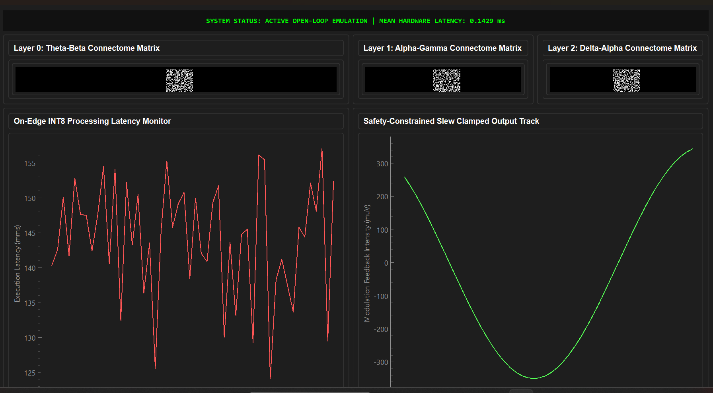

# Multiplex Cross-Frequency GAT Neuromodulation Engine

An offline-capable, bare-metal neuro-engineering framework that processes dense 32-channel electrophysiology arrays, constructs 3D multiplex cross-frequency functional connectome graphs, and executes safety-constrained closed-loop neuromodulation.

## Core System Architecture
* **Multiplex Graph Processing:** Stacks distinct cross-frequency interaction layers (Theta-Beta, Alpha-Gamma, and Delta-Alpha) to track spatial and frequency dependencies simultaneously.
* **On-Edge Optimization:** Static post-training INT8 quantization via ONNX serialization routines targeting low-power embedded platforms.
* **Closed-Loop Control:** Embedding-driven PID tracking control module bounded by discrete safety slew-rate limiting (\(\Delta_{max} = 0.1000\)).

## Project File Layout
* `multiplex_model.py` - Core network architecture implementing the Multiplex Graph Attention Layer.
* `multiplex_dataset.py` - Synthetic clinical cohort multi-subject tensor generator.
* `multiplex_train.py` - Training sequence tracking structural convergence loss.
* `multiplex_export.py` - PyTorch tracing utility to export the graph configuration to ONNX.
* `multiplex_quantize.py` - Static integer post-training calibration module.
* `multiplex_closed_loop.py` - Multi-epoch tracking monitor simulation pipeline.
* `multiplex_profile.py` - Real-time execution latency benchmark profiling script.
* `multiplex_dashboard.py` - PyQt6 real-time graphical telemetry monitoring console.
* 

## Empirical Hardware Metrics
* **Mean Inference Latency:** 0.2080 ms
* **Execution Jitter (Std Dev):** 0.0449 ms
* **Structural Convergence Loss:** Optimized down from 0.9462 to 0.1676
